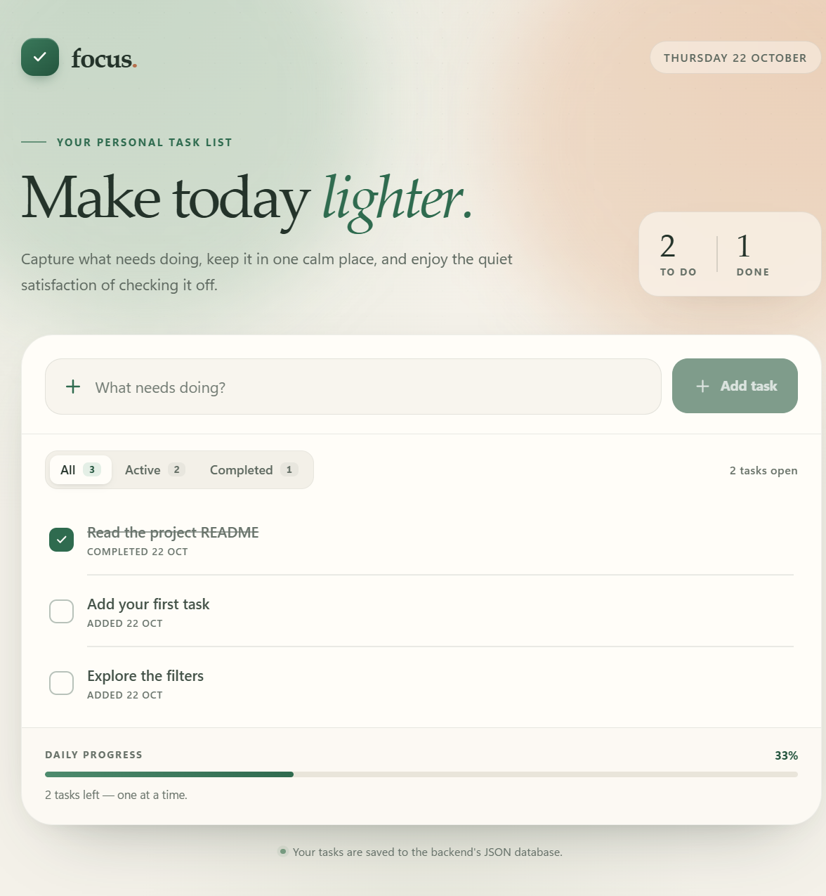

# Focus — Full-Stack To-Do List

A modern, responsive to-do application built with **React + Vite** on the frontend and **Node.js + Express** on the backend. Tasks are stored in a JSON file on the server, so they survive page refreshes and server restarts.



The project is intentionally split into two independent applications so you can see how a real client/server architecture works:

- **frontend/** — renders the UI and calls the REST API.
- **backend/** — owns the data, validation, and HTTP endpoints.

---

## Features

### Frontend

- Add, display, edit, complete, and delete tasks
- Filter by **All**, **Active**, and **Completed**
- Inline editing with Enter to save and Escape to cancel
- Responsive layout for desktop, tablet, and mobile
- Loading skeletons, empty states, and error states
- Accessible labels, keyboard focus styles, and reduced-motion support
- All API calls live in `src/api/todos.js`
- Vite development proxy from `/api` to the Express server
- Production API URL configured with `VITE_API_URL`

### Backend

- Express REST API with JSON request and response bodies
- Health-check endpoint
- Full CRUD for tasks
- Request validation with useful field-level error messages
- Correct HTTP status codes (`200`, `201`, `204`, `400`, `403`, `404`, `500`)
- Consistent error response shape
- Configurable CORS allowlist for local and deployed frontends
- JSON-file persistence with queued writes and atomic file replacement
- Automated API tests using Node's built-in test runner

---

## Tech stack

| Layer    | Tools                                        |
| -------- | -------------------------------------------- |
| Frontend | React, Vite, JavaScript, HTML, CSS, Fetch API |
| Backend  | Node.js, Express, CORS, JSON file storage     |
| Testing  | `node:test`, Node's built-in `fetch`          |

---

## Project structure

```text
todo-list-app/
├── frontend/
│   ├── public/
│   │   ├── favicon.svg
│   │   └── robots.txt
│   ├── src/
│   │   ├── api/
│   │   │   └── todos.js          # All HTTP calls to the backend
│   │   ├── components/
│   │   │   ├── AddTodoForm.jsx
│   │   │   ├── EmptyState.jsx
│   │   │   ├── ErrorBanner.jsx
│   │   │   ├── FilterBar.jsx
│   │   │   ├── Icons.jsx
│   │   │   ├── LoadErrorState.jsx
│   │   │   ├── TodoItem.jsx
│   │   │   ├── TodoList.jsx
│   │   │   └── TodoListSkeleton.jsx
│   │   ├── App.jsx
│   │   ├── main.jsx
│   │   └── styles.css
│   ├── .env.example
│   ├── index.html
│   ├── package.json
│   └── vite.config.js
├── docs/
│   └── preview.png
├── backend/
│   ├── data/
│   │   └── todos.json            # The JSON "database"
│   ├── src/
│   │   ├── lib/
│   │   │   ├── httpError.js
│   │   │   ├── todoStore.js      # File persistence and queued writes
│   │   │   └── validation.js
│   │   ├── middleware/
│   │   │   ├── asyncHandler.js
│   │   │   └── errorHandler.js
│   │   ├── routes/
│   │   │   └── todos.js
│   │   ├── app.js
│   │   ├── server.js
│   │   └── todoStoreInstance.js
│   ├── test/
│   │   └── api.test.js
│   ├── .env.example
│   └── package.json
├── .gitignore
└── README.md
```

---

## Prerequisites

- **Node.js 18 or newer** — check with `node --version`
- **npm** — check with `npm --version`
- Two terminals, one for each application

The project was built and verified with Node.js 24 and npm 11, but the code only requires Node 18+.

---

## Run locally

### 1. Start the backend

```powershell
cd todo-list-app/backend
npm install
Copy-Item .env.example .env    # Windows PowerShell
# cp .env.example .env         # macOS / Linux
npm run dev
```

The API runs at **http://localhost:5000**.

Check it in a browser or with curl:

```powershell
curl.exe http://localhost:5000/api/health
```

### 2. Start the frontend

Open a **new terminal**:

```powershell
cd todo-list-app/frontend
npm install
npm run dev
```

Open **http://localhost:5173**.

During development, requests to `/api` are proxied by Vite to `http://localhost:5000`, so the app works with no frontend environment variables.

> The starter JSON file contains three sample tasks. Edit or delete them like any other task.

---

## Environment variables

### Backend — `backend/.env`

| Variable         | Default                                             | Purpose                                                   |
| ---------------- | --------------------------------------------------- | --------------------------------------------------------- |
| `PORT`           | `5000`                                              | Port the Express server listens on                        |
| `CLIENT_ORIGINS` | `http://localhost:5173,http://127.0.0.1:5173`       | Comma-separated browser origins allowed by CORS           |

Example production value:

```env
PORT=5000
CLIENT_ORIGINS=https://my-todo-app.vercel.app,https://www.my-todo-app.com
```

Do not add a trailing slash to an origin. An origin looks like `https://example.com`, not `https://example.com/`.

### Frontend — `frontend/.env`

| Variable       | Default | Purpose                                                     |
| -------------- | ------- | ----------------------------------------------------------- |
| `VITE_API_URL` | `/api`  | Base URL of the API. Vite's `/api` proxy is used by default |

For a deployed backend:

```env
VITE_API_URL=https://my-todo-api.onrender.com/api
```

Vite reads environment variables at **build time**, so rebuild the frontend after changing `VITE_API_URL`.

---

## API reference

Base URL in development: `http://localhost:5000/api`

### `GET /api/health`

Returns the API status.

```json
{
  "status": "ok",
  "timestamp": "2026-10-22T17:30:00.000Z",
  "uptime": 42
}
```

### `GET /api/todos`

Returns every task.

```json
{
  "todos": [
    {
      "id": "8f14e45f-ceea-4a67-9b2b-0e6f6a1a7a01",
      "title": "Read the project README",
      "completed": true,
      "createdAt": "2026-10-21T09:15:00.000Z",
      "updatedAt": "2026-10-22T08:30:00.000Z"
    }
  ],
  "count": 1
}
```

### `POST /api/todos`

Creates a task.

Request:

```json
{
  "title": "Plan the week",
  "completed": false
}
```

- `title` is required, must be a string, and is trimmed. Maximum 200 characters.
- `completed` is optional and defaults to `false`.

Response: **201 Created**

```json
{
  "todo": {
    "id": "58a83dc4-7f0a-4a56-b113-57aa421ab283",
    "title": "Plan the week",
    "completed": false,
    "createdAt": "2026-10-22T17:35:00.000Z",
    "updatedAt": "2026-10-22T17:35:00.000Z"
  }
}
```

The response also includes a `Location` header pointing to the new task.

### `PATCH /api/todos/:id`

Updates a task's title, completed state, or both. At least one field is required.

```json
{
  "title": "Plan next week",
  "completed": true
}
```

Response: **200 OK** with the updated task in `{ "todo": { ... } }`.

### `DELETE /api/todos/:id`

Deletes a task.

Response: **204 No Content** with an empty body.

### Error responses

All API errors use the same shape:

```json
{
  "error": {
    "code": "VALIDATION_ERROR",
    "message": "The request contains invalid data.",
    "details": [
      {
        "field": "title",
        "message": "Title cannot be empty."
      }
    ]
  }
}
```

Possible codes include:

| Code                    | Status | Meaning                                      |
| ----------------------- | ------ | -------------------------------------------- |
| `VALIDATION_ERROR`      | 400    | A field is missing or invalid                |
| `INVALID_BODY`          | 400    | The JSON body is not an object               |
| `INVALID_JSON`          | 400    | The request body is not valid JSON           |
| `CORS_NOT_ALLOWED`      | 403    | The browser origin is not in the allowlist   |
| `NOT_FOUND`             | 404    | The route does not exist                     |
| `TODO_NOT_FOUND`        | 404    | The requested task does not exist            |
| `INTERNAL_SERVER_ERROR` | 500    | An unexpected server-side error              |

### curl examples

PowerShell users should use `curl.exe` instead of `curl`, because plain `curl` is an alias for `Invoke-WebRequest` in Windows PowerShell.

```powershell
$base = "http://localhost:5000/api"

# List tasks
curl.exe "$base/todos"

# Create a task
curl.exe -X POST "$base/todos" `
  -H "Content-Type: application/json" `
  -d '{\"title\":\"A new task\"}'

# Complete a task (replace the ID)
curl.exe -X PATCH "$base/todos/TODO_ID" `
  -H "Content-Type: application/json" `
  -d '{\"completed\":true}'

# Delete a task (replace the ID)
curl.exe -X DELETE "$base/todos/TODO_ID"
```

---

## How the JSON database works

The file `backend/data/todos.json` stores an array of task objects:

```json
[
  {
    "id": "8f14e45f-ceea-4a67-9b2b-0e6f6a1a7a01",
    "title": "Read the project README",
    "completed": true,
    "createdAt": "2026-10-21T09:15:00.000Z",
    "updatedAt": "2026-10-22T08:30:00.000Z"
  }
]
```

`TodoStore` does a few important things:

1. **Loads the file once** when the server starts.
2. **Queues writes** so two requests cannot modify the file at the same time.
3. **Writes to a temporary file**, then renames it over `todos.json`. This prevents a half-written file if the server stops mid-write.
4. **Rolls back the in-memory change** if persistence fails.

If you want to edit the data file by hand, stop the server first. Otherwise the running server may overwrite your changes on its next write.

If the file contains invalid JSON, the server refuses to start and prints a clear error instead of silently losing data.

---

## Available scripts

### Frontend

| Command           | What it does                                  |
| ----------------- | --------------------------------------------- |
| `npm run dev`     | Start Vite at http://localhost:5173           |
| `npm run build`   | Create the production build in `dist/`        |
| `npm run preview` | Preview the production build at port 4173     |

### Backend

| Command         | What it does                                    |
| --------------- | ----------------------------------------------- |
| `npm run dev`   | Start Express with Node's file watcher          |
| `npm start`     | Start Express normally                          |
| `npm test`      | Run the API integration tests                   |

Run the backend tests:

```powershell
cd todo-list-app/backend
npm test
```

The tests use a temporary data file, so they never touch `data/todos.json`.

---

## How a request flows

1. The user submits the form in `AddTodoForm.jsx`.
2. `App.jsx` calls `createTodo()` from `src/api/todos.js`.
3. The service sends `POST /api/todos` with a JSON body.
4. Express routes the request to `src/routes/todos.js`.
5. `validation.js` checks the body before it reaches the data store.
6. `TodoStore` updates the in-memory list and persists it to JSON.
7. The API responds with the created task.
8. React adds the returned task to state, and the UI updates.

This is why the backend validates data even though the frontend has a required input: browser checks can be bypassed, so the server must always be the source of truth.

---

## Deployment

### Backend (Render, Railway, Fly.io, etc.)

- Set the project root to `todo-list-app/backend`.
- Build command: `npm install`
- Start command: `npm start`
- Add environment variables:
  - `PORT` — usually provided automatically by the host
  - `CLIENT_ORIGINS` — your deployed frontend origin(s)
- Add a **persistent disk** if the host uses ephemeral filesystems. Without one, `todos.json` will reset when the service redeploys or restarts.

### Frontend (Vercel, Netlify, Cloudflare Pages, etc.)

- Set the project root to `todo-list-app/frontend`.
- Build command: `npm run build`
- Output directory: `dist`
- Add `VITE_API_URL` with the deployed API URL, for example:
  `VITE_API_URL=https://my-todo-api.onrender.com/api`

After deploying the frontend, copy its exact origin into the backend's `CLIENT_ORIGINS` and restart the backend.

**Production note:** a JSON file is excellent for learning and small single-server projects, but it is not a good long-term database for multi-instance or serverless deployments. For a real production app, move the persistence layer to PostgreSQL, SQLite with a managed volume, or another database while keeping the same HTTP API.

---

## Troubleshooting

### “Could not reach the server”

- Make sure the backend is running at http://localhost:5000.
- Check `curl.exe http://localhost:5000/api/health`.
- Make sure no other process is using port 5000.
- If the frontend is deployed, confirm `VITE_API_URL` points to the deployed API and rebuild.

### CORS error in the browser

Add the frontend's exact origin to `CLIENT_ORIGINS`, then restart the backend:

```env
CLIENT_ORIGINS=http://localhost:5173,https://your-frontend.example.com
```

Do not include paths or a trailing slash.

### Port already in use

Change `PORT` in `backend/.env` and the target in `frontend/vite.config.js` to match.

### Tasks disappeared after a redeploy

The hosting environment is likely ephemeral. Attach a persistent volume or use a real database. See the deployment section above.

### `todos.json` is not valid JSON

Stop the server, fix the file (or replace it with `[]`), and start the server again. Restore from version control or a backup if needed.

---

## Ideas for extending the project

- Add due dates, priorities, and sort controls
- Add drag-and-drop reordering
- Add search and optimistic UI updates
- Add user accounts and authentication
- Replace the JSON store with SQLite or PostgreSQL
- Add pagination to `GET /api/todos`
- Add Playwright end-to-end tests for the React UI

---

## What to study in the code

- `backend/src/lib/todoStore.js` — queued writes, atomic file replacement, rollback
- `backend/src/lib/validation.js` — request validation and field-level errors
- `backend/src/middleware/errorHandler.js` — one consistent error response
- `frontend/src/api/todos.js` — a small reusable API service
- `frontend/src/App.jsx` — loading/error state and server-synced updates
- `frontend/src/components/TodoItem.jsx` — inline editing and accessibility
- `frontend/src/styles.css` — responsive design tokens with no CSS framework
